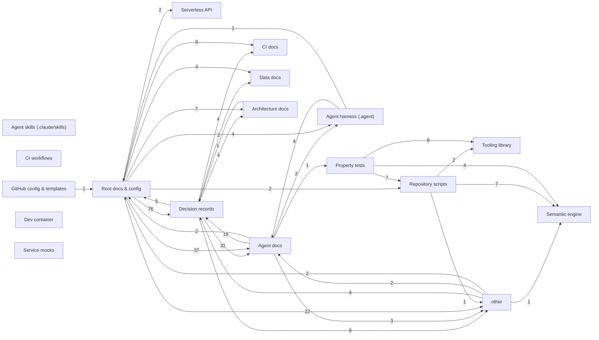

# Architecture Graph

> **Generated file — do not edit by hand.**
> Regenerate with `node scripts/architecture-graph.mjs --write`.
> `guard` and the `architecture` workflow fail when this file is stale.

**168 tracked files · 17 components · 34 directed links**

## Component map

## Components

| Component | Files |
| --- | --- |
| `scripts` — Repository scripts | 34 |
| `adr` — Decision records | 25 |
| `agent-harness` — Agent harness (.agent) | 19 |
| `root` — Root docs & config | 18 |
| `github-config` — GitHub config & templates | 17 |
| `docs-agents` — Agent docs | 10 |
| `tests` — Property tests | 10 |
| `workflows` — CI workflows | 10 |
| `semantic` — Semantic engine | 6 |
| `docs-arch` — Architecture docs | 4 |
| `skills` — Agent skills (.claude/skills) | 4 |
| `docs-ci` — CI docs | 3 |
| `mocks` — Service mocks | 2 |
| `tooling-lib` — Tooling library | 2 |
| `api` — Serverless API | 1 |
| `docs-data` — Data docs | 1 |
| `sandbox` — Dev container | 1 |

## Heaviest links

| From | To | References |
| --- | --- | --- |
| `root` | `adr` | 76 |
| `root` | `docs-agents` | 37 |
| `adr` | `docs-agents` | 31 |
| `root` | `other` | 22 |
| `docs-agents` | `adr` | 19 |
| `adr` | `other` | 8 |
| `root` | `docs-ci` | 8 |
| `tests` | `tooling-lib` | 8 |
| `root` | `docs-arch` | 7 |
| `scripts` | `semantic` | 7 |
| `tests` | `scripts` | 7 |
| `adr` | `root` | 5 |
| `adr` | `docs-arch` | 4 |
| `adr` | `docs-ci` | 4 |
| `agent-harness` | `docs-agents` | 4 |

## How this stays alive

1. The graph is derived from the files that exist — links and imports, nothing invented.
2. `--check` compares the committed output to a fresh render, byte for byte.
3. Structural changes therefore cannot land without updating the picture (no doc drift).
